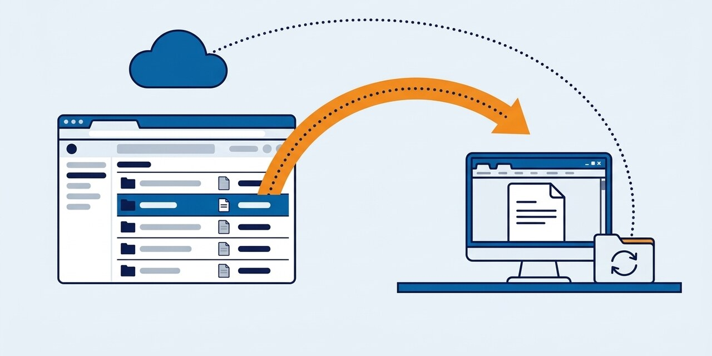
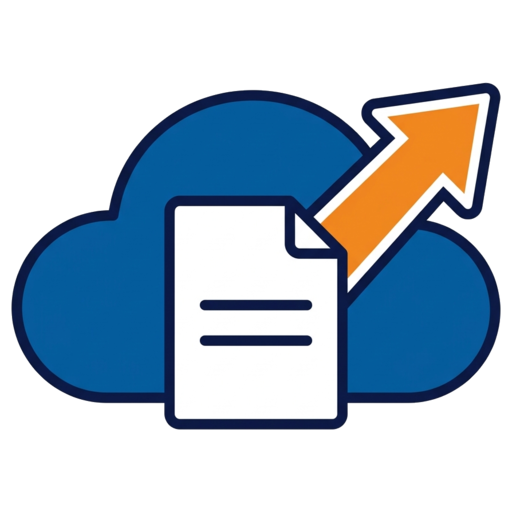
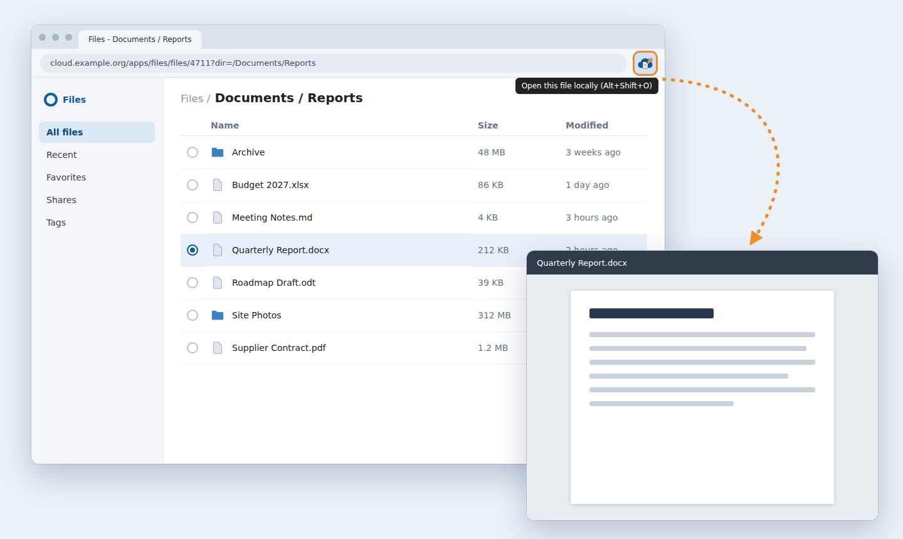
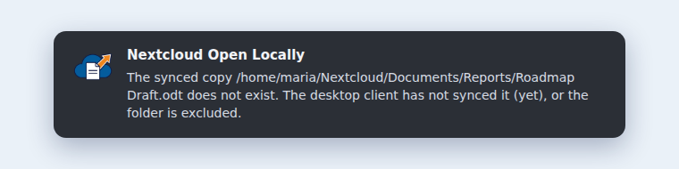

<p align="center"></p>

<table>
<tr>
<td width="100">

</td>
<td>
<h1>Nextcloud Open Locally</h1>
Browser extension that opens the Nextcloud file you are looking at in your local desktop app
</td>
</tr>
</table>

[](https://github.com/frederikb96/nextcloud-open-local/actions/workflows/ci.yaml)
[](https://github.com/frederikb96/nextcloud-open-local/releases)
[](https://opensource.org/licenses/MIT)

You are looking at a document in Nextcloud's web interface and want it in LibreOffice, a code editor or whatever your system uses for that file type. Press the toolbar button or `Alt+Shift+O`, and the file opens from the copy the Nextcloud desktop client already keeps in sync, so saving it there uploads it the usual way. When there is no local copy, a notification says so.

<p align="center"></p>

## Why

- **No download, no upload.** The file is the one the desktop client syncs, not a copy from the browser's download folder that has to find its way back.
- **Nothing to configure.** The server, the account and the folder are read from the page and from the desktop client's own configuration.
- **No special link handler.** The opener is a small native messaging host registered for this extension only, instead of a URL scheme registered with the whole system.
- **Narrow reach.** The extension asks for no host permission, sends two read-only WebDAV requests from the tab you clicked in, and never reads or writes a file.

## How it fits together

```
Files page ▶ extension ▶ WebDAV: file id to path ▶ native message ▶ opener ▶ synced file ▶ your application
```

The extension turns the file shown in the page into its path in Nextcloud, using the signed-in session of the page. The opener, a Python file that runs on your computer only, turns that path into the file in your synced folder and starts the application. [How it works](docs/how-it-works.md) has the details.

## What you need

- A Chromium-based browser on Linux
- The Nextcloud desktop client, syncing a folder that holds the file
- `python3` for the opener (standard library only)

## Install

Download `nextcloud-open-local.zip` and `nextcloud_open_local.py` from the [latest release](https://github.com/frederikb96/nextcloud-open-local/releases/latest). Register the opener with your browsers, then load the unzipped extension:

```sh
python3 nextcloud_open_local.py --install
```

In `chrome://extensions` (`edge://extensions`) switch on developer mode, choose *Load unpacked* and select the folder with `manifest.json`. The [install guide](docs/install.md) covers each browser, updating and removing it.

## When nothing opens

A notification explains what is missing, for example a file the desktop client has not downloaded yet:

<p align="center"></p>

## Docs

- [Install](docs/install.md): both pieces, each browser, updating and uninstalling
- [How it works](docs/how-it-works.md): the path from click to application, what is refused, the permissions
- [Troubleshooting](docs/troubleshooting.md): every message the extension can show and what to do
- [Development](docs/development.md): building, the tests, the pictures, releasing

## Prior art

Nextcloud's web interface has its own *Edit locally* action. As far as I can tell it hands an `nc://` link to the desktop client, which has to be registered as that link's handler with the system, and it is meant for editing with the file locked on the server ([desktop client FAQ](https://docs.nextcloud.com/server/stable/user_manual/en/desktop/faq.html)). This extension is a different route to the same place for people who only want to open the synced file: a toolbar button, no link handler, no locking. It shares no code with it.

## Not affiliated

This project is not affiliated with, endorsed by or sponsored by Nextcloud GmbH. Nextcloud is a trademark of its owner. The pictures show an invented stand-in for a Files page.

## Known limitations

- **Linux first.** The opener contains the macOS config path and `open`, which have not been run. Windows is not supported.
- **A browser in a sandbox**, such as a flatpak, probably cannot start the opener, which lives outside it. The installer still writes a manifest for flatpak Chromium; this is untested.
- **Browsers.** The automated tests run in Chromium. Chrome and Edge read the same kind of manifest and the opener registers with both; they are not part of the automated tests.
- **The desktop client's configuration** is parsed according to the layout of `nextcloud.cfg` the client is known to write. How that layout varies between client versions is not verified; a different one makes the opener report that no account matches.
- **The synced copy only.** A file that is not downloaded is never fetched; the extension says so instead.
- **Address forms.** Only the Files app, permalinks and the OnlyOffice, Collabora and Text editor addresses are understood.

## What leaves the machine

Nothing goes to a third party. The extension talks to the Nextcloud server of the tab you clicked in, with that page's session, and to the opener on your computer. There is no telemetry and no other server.

## License

[MIT](LICENSE)
